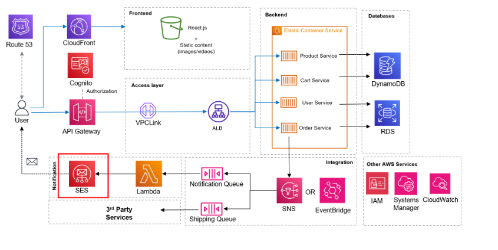

## Deployment of ecommerce website with ECS and ECR 

# Project Introduction

This project demonstrates the design, containerization, and deployment of a scalable, secure, and highly available cloud-native e-commerce application on Amazon Web Services (AWS) using a microservices-based architecture.

The application is designed to simulate a modern e-commerce platform where different business functionalities, such as product management, shopping cart, user management, and order processing, are deployed as independent microservices. This architecture improves scalability, maintainability, fault isolation, and flexibility.

The frontend is built using React.js, with static content and media hosted on Amazon S3 and delivered globally through Amazon CloudFront. Amazon Route 53 manages domain routing, while Amazon Cognito provides user authentication and authorization. Amazon API Gateway acts as the entry point for API requests, which are routed through a secure VPC Link and Application Load Balancer (ALB) to backend services running on Amazon ECS.

The application uses Amazon DynamoDB and Amazon RDS for data persistence. AWS Lambda, Amazon Simple Notification Service (SNS), Amazon Simple Queue Service (SQS), Amazon EventBridge, and Amazon SES support event-driven integration, asynchronous processing, and email notifications.

Additional AWS services, including IAM, AWS Systems Manager, and Amazon CloudWatch, help manage access, operational configuration, monitoring, and troubleshooting.

# Project Objectives

Build and deploy a modern e-commerce application using a microservices architecture.

Containerize backend services using Docker.

Deploy and manage containerized applications using Amazon ECS.

Host frontend assets on Amazon S3 and distribute them through Amazon CloudFront.

Implement secure API routing using Amazon API Gateway, VPC Link, and an Application Load Balancer.

Integrate Amazon DynamoDB and Amazon RDS for database operations.

Implement asynchronous workflows and event-driven integrations using AWS Lambda, SQS, SNS, and EventBridge.

Configure authentication, access management, monitoring, and logging using AWS security and management services.

Develop practical skills in cloud deployment, application networking, scalability, security, and DevOps.

# Architecture Overview

The application is organized into the following layers:

Frontend Layer: React.js, Amazon S3, and Amazon CloudFront.

Access Layer: Amazon Route 53, Amazon Cognito, Amazon API Gateway, VPC Link, and Application Load Balancer.

Backend Layer: Amazon ECS running independent Product, Cart, User, and Order microservices.

Database Layer: Amazon DynamoDB and Amazon RDS.

Integration Layer: AWS Lambda, Amazon SQS, Amazon SNS, Amazon EventBridge, and Amazon SES.

Security and Monitoring Layer: AWS IAM, AWS Systems Manager, and Amazon CloudWatch.

# Technologies Used

Cloud Platform: Amazon Web Services (AWS)

Frontend: React.js

Containerization: Docker

Container Orchestration: Amazon ECS

Networking and Content Delivery: Amazon VPC, ALB, VPC Link, CloudFront, Route 53

API Management: Amazon API Gateway

Databases: Amazon DynamoDB, Amazon RDS

Serverless and Messaging: AWS Lambda, Amazon SQS, Amazon SNS, Amazon EventBridge

Authentication and Notifications: Amazon Cognito, Amazon SES

Security and Monitoring: AWS IAM, Systems Manager, Amazon CloudWatch

Version Control: Git and GitHub

# Expected Outcome

The outcome of this project is a cloud-native e-commerce application demonstrating how modern applications can be deployed on AWS using containers, managed databases, secure networking, content delivery, and event-driven services.

This project provides hands-on experience with AWS infrastructure, Docker-based microservices, application deployment, cloud security, monitoring, and DevOps practices.

# Learning Focus

This project is intended for hands-on learning and practical implementation of AWS Cloud Engineering, Docker, Microservices, Cloud Networking, and DevOps deployment workflows.

# Lets Go to Software Installation 

- [Software Installation](docs/installation.md)
