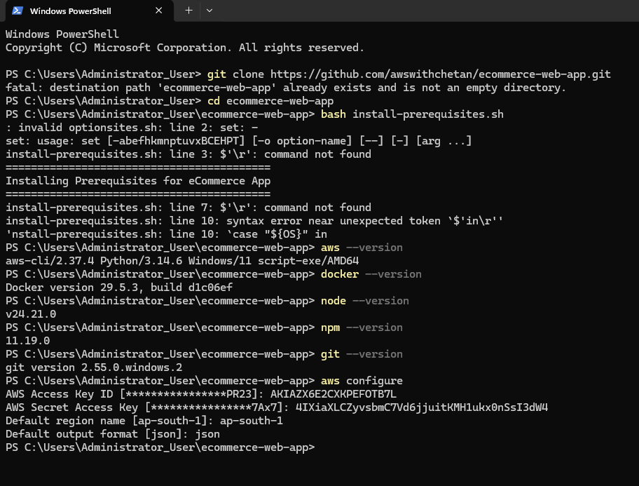

## Step By Step Configuration


## Prerequisites and Software Requirements

Before deploying the e-commerce application on AWS using Amazon ECS and Amazon ECR, install the following software on your local machine.

### Required Software

| Software | Purpose |
|---|---|
| AWS CLI | Configure AWS credentials and manage AWS resources from the command line. |
| Docker | Build container images and run containers locally. |
| Node.js | Run JavaScript-based tools and application components. |
| npm | Install Node.js application dependencies. |
| Python | Support scripts and automation tasks. |
| Git | Clone the repository and manage source code. |
| Bash | Execute the prerequisite installation script. |

### Verify Software Installation

Run the following commands in PowerShell to verify the installed tools.

```powershell
aws --version
python --version
docker --version
node --version
npm --version
git --version
bash --version
```

### Configure AWS CLI

Configure your AWS credentials and default region:

```powershell
aws configure
```

Verify that AWS CLI can access your configured identity:

```powershell
aws sts get-caller-identity
```

### Prerequisite Installation Script

The repository contains an `install-prerequisites.sh` script for setting up the required environment.

Run the script using Bash:

```bash
bash install-prerequisites.sh
```

If the script reports `'$'\r': command not found`,
convert the file from Windows CRLF to Unix LF line endings
and execute it again.

### Expected Outcome

- Required software is installed and accessible from the terminal.
- AWS CLI is configured for the intended AWS account.
- Docker is available for container image builds.
- Node.js and npm are available for application dependencies.
- The prerequisite script runs without line-ending errors.
- 

