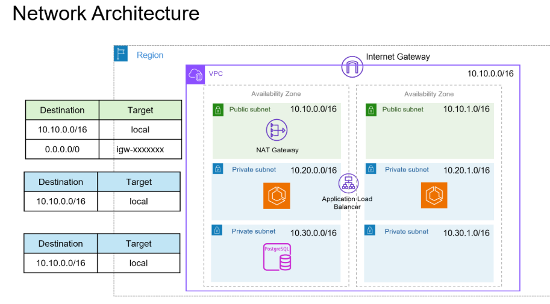
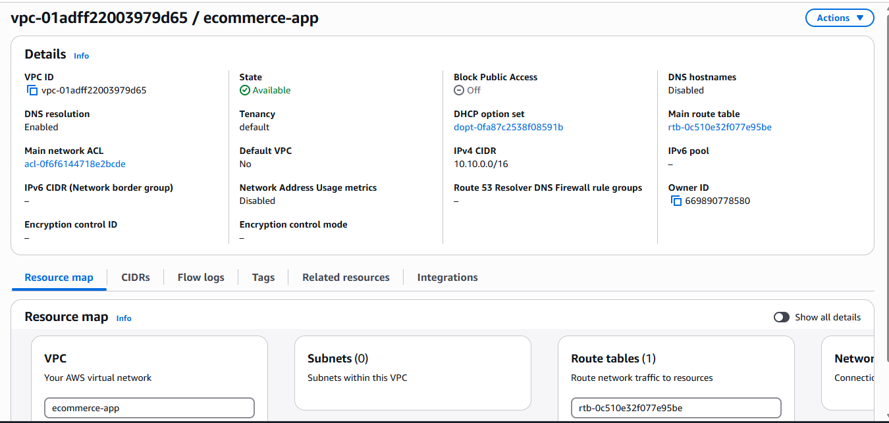
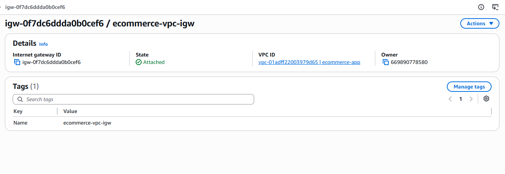
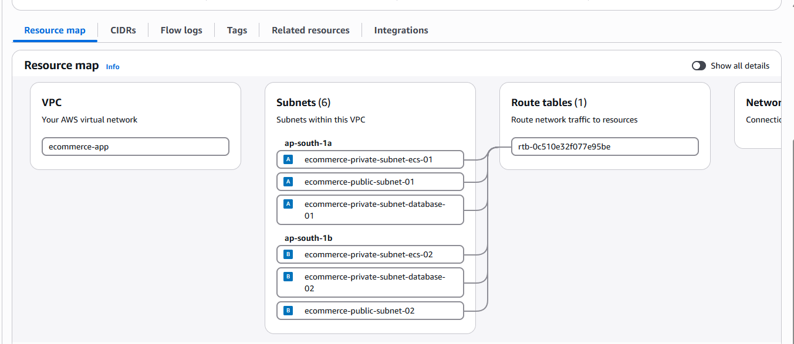
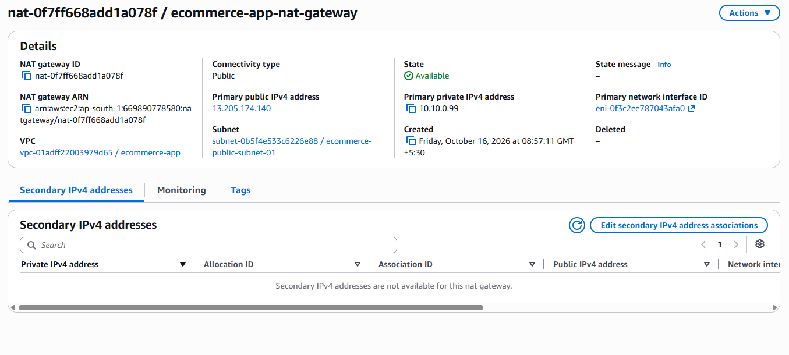
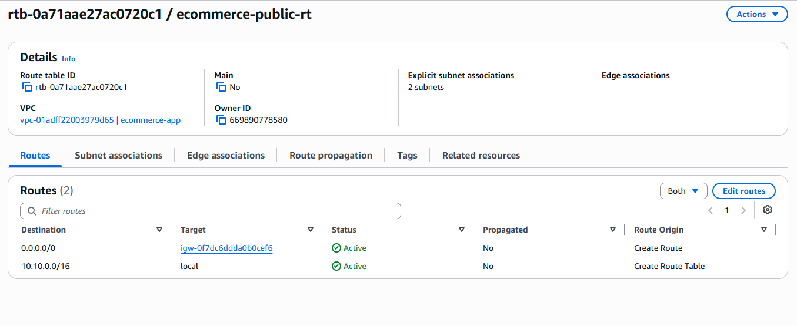
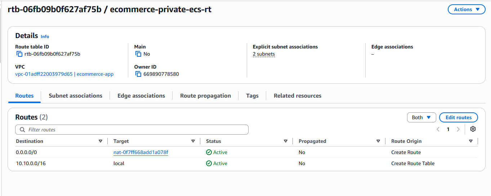
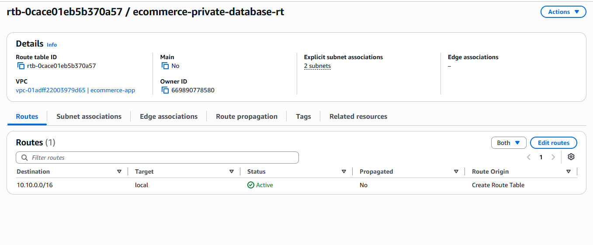
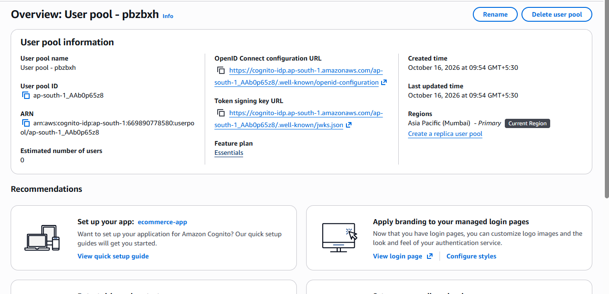
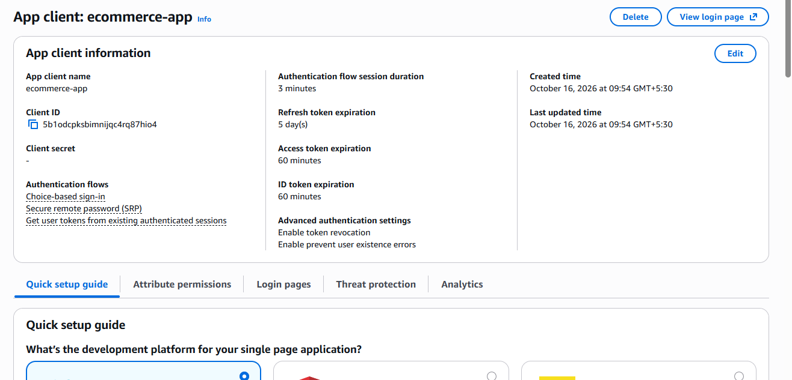

## AWS Network Architecture

### 1. Overview

The e-commerce website is deployed on AWS using a secure, highly available network architecture. The architecture uses an Amazon VPC with public and private subnets distributed across two Availability Zones.

The Application Load Balancer receives incoming application traffic and distributes it across the backend Amazon ECS services. The database is placed in private subnets to prevent direct access from the internet.

### 2. Network Architecture Components

| AWS Component | Configuration | Purpose |
|---|---|---|
| AWS Region | Selected AWS Region | Hosts all project resources. |
| Amazon VPC | `10.10.0.0/16` | Provides an isolated network for the application. |
| Internet Gateway | Attached to the VPC | Enables internet connectivity for resources with appropriate routing and public addressing. |
| Public Subnet 1 | `10.10.0.0/16` (as shown in the diagram) | Intended to host public-facing networking resources. |
| Public Subnet 2 | `10.10.1.0/16` (as shown in the diagram) | Provides a second Availability Zone for network availability. |
| Private Subnet 1 | `10.20.0.0/16` (as shown in the diagram) | Intended for backend ECS application services. |
| Private Subnet 2 | `10.20.1.0/16` (as shown in the diagram) | Provides a second Availability Zone for backend services. |
| Private Database Subnet 1 | `10.30.0.0/16` (as shown in the diagram) | Intended for the database tier. |
| Private Database Subnet 2 | `10.30.1.0/16` (as shown in the diagram) | Supports database subnet redundancy across Availability Zones. |
| Application Load Balancer | Deployed across public subnets | Receives HTTP/HTTPS traffic and forwards requests to healthy application targets. |
| Amazon ECS | Backend containerized services | Runs the e-commerce application containers. |
| Amazon RDS | Database tier | Stores application data securely. |
| NAT Gateway | Public subnet | Allows private-subnet resources to initiate outbound internet connections without accepting unsolicited inbound connections. |

> **Important:** The CIDR blocks in the diagram need correction before implementation. The VPC is `10.10.0.0/16`, so subnet CIDRs must be smaller ranges contained within that VPC. For example, use `10.10.1.0/24`, `10.10.2.0/24`, `10.10.11.0/24`, `10.10.12.0/24`, `10.10.21.0/24`, and `10.10.22.0/24` for six distinct subnets.

### 3. VPC and Subnet Design

The VPC provides the private network boundary for the application. Subnets divide this network into separate tiers.

- **Public subnets:** Host the internet-facing Application Load Balancer and NAT Gateway.
- **Private application subnets:** Host ECS tasks that run the backend application.
- **Private database subnets:** Host the RDS database, isolated from direct public internet access.

The subnets should be distributed across two Availability Zones to improve resilience and reduce the impact of an Availability Zone failure.

### 4. Route Table Configuration

#### Public Route Table

Associate this route table with both public subnets.

| Destination | Target | Purpose |
|---|---|---|
| VPC CIDR | `local` | Allows communication within the VPC. |
| `0.0.0.0/0` | Internet Gateway (`igw-xxxxxxxx`) | Routes internet-bound IPv4 traffic through the Internet Gateway. |

The public subnets are suitable for internet-facing resources when their network interfaces and security rules permit the required traffic.

#### Private Application Route Table

Associate the route table with the private application subnets.

| Destination | Target | Purpose |
|---|---|---|
| VPC CIDR | `local` | Allows communication within the VPC. |
| `0.0.0.0/0` | NAT Gateway | Allows outbound internet access when required, for example to retrieve external dependencies. |

For high availability, consider deploying one NAT Gateway per Availability Zone and routing each private subnet through the NAT Gateway in its own Availability Zone.

#### Private Database Route Table

Associate the route table with the database subnets.

| Destination | Target | Purpose |
|---|---|---|
| VPC CIDR | `local` | Allows private communication between authorized VPC resources. |

The database subnets do not require a default route to an Internet Gateway. Keep database access restricted to the application tier.

### 5. Application Traffic Flow

#### Incoming Traffic

1. A customer opens the e-commerce website in a browser.
2. DNS resolves the website domain to the appropriate public endpoint.
3. The request reaches the internet-facing Application Load Balancer.
4. The load balancer forwards the request to a healthy ECS application target.
5. The ECS application processes the request.
6. When required, the application communicates with the RDS database over the private network.
7. The response returns to the customer through the established network connections.

#### Outbound Traffic from Private Subnets

1. An ECS task needs to access an external service or download a dependency.
2. The private subnet route table forwards the internet-bound traffic to a NAT Gateway.
3. The NAT Gateway forwards the traffic through the Internet Gateway.
4. Return traffic follows the established connection back to the originating task.

The NAT Gateway provides outbound connectivity; it does not expose private ECS tasks directly to unsolicited inbound internet traffic.

### 6. Security Configuration

- Allow inbound HTTPS traffic on port `443` to the public Application Load Balancer.
- Allow HTTP on port `80` only when needed for redirection to HTTPS or another explicitly intended use.
- Allow the ECS application port only from the Application Load Balancer security group.
- Allow the database port only from the ECS application security group.
- Keep ECS tasks and RDS instances private wherever possible.
- Use IAM roles for ECS task permissions rather than embedding AWS access keys in application code.
- Use HTTPS certificates and AWS Secrets Manager or another approved secret-management solution for sensitive configuration.

### 7. High Availability

The architecture uses two Availability Zones for the load balancer and application tier. The database tier should use an appropriate RDS Multi-AZ configuration if high availability is required.

For production deployment, ensure that:
- The Application Load Balancer spans at least two public subnets in different Availability Zones.
- ECS tasks can run in both private application subnets.
- Database subnets belong to an RDS DB subnet group spanning at least two Availability Zones.
- Routing, security groups, health checks, and application dependencies are configured correctly.

# Step 1 : - Create VPC 

# Step 2 : - Create Internet gateway and attach to VPC

# Step 3 : - Create Subnet

# Step 4 : - Create NAT gateway

# Step 5 : - Create route table

# Step 6 : -  Create Cognito User Pool and Client App:

